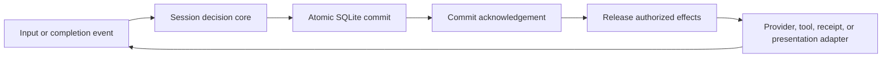

# Durable sessions in native Bee

Status: stages 1–6 implemented: decision core, simulator, SQLite store,
registry/evidence adapter, shared driver, persistent budgets and wakes, and the
investigation acceptance fixture with per-probe recovery. Created and updated 2026-10-30. The default invocation
remains non-durable; [native research tooling](native-research-tooling.md) describes
the underlying tools and evidence model.

## Stage 1 implementation

[`session::durable`](../src/session/durable/mod.rs) is available with and without
the TUI feature. It models operation admission, execution, result delivery,
recovery, bounded safe retries, deadlines, and cancellation. It has no I/O and
is driven by the optional stage 4 adapter for `bee run` and `bee repl`.

The host opens a validated snapshot with a fresh activation ID and submits events
to `on_event`. A `Persist` effect contains the candidate snapshot, expected storage
revision, and commit identity. Only a matching `Committed` event promotes that
candidate and releases dependent effects. `CommitFailed`, including an ambiguous
acknowledgement, suspends the instance until the host reloads storage and opens a
new activation. The simulator exercises both persisted and unpersisted outcomes.

Adapter obligations for the next slices:

- Acquire exclusive ownership before open, provide a globally fresh activation ID
  even after an uncommitted activation, and atomically store the exact candidate
  only at its expected revision. The core cannot verify a storage acknowledgement.
- Serialize event handling. `Busy` means a commit is pending: retain and redeliver
  that event instead of dropping a tool completion. Bound the adapter's queue.
- Recheck current policy, tool/profile compatibility, and deadlines at execution.
  `Authorize` is a trusted host event; operation recovery policy is trusted
  registration data. Neither is model-selected authority.
- Resolve `Inspect` and `Stop` using executor evidence. Quiescence means the old
  executor is stopped, not merely unreachable. A recovered result must belong to
  the exact original attempt. Stopped attempts retain their identity; cleanup
  does not establish that their external effects never happened.
- Deduplicate presentation by stable session ID and entry sequence. Reopen can
  redeliver committed entries; `Replay` accepts the last consumed sequence.

The current checkpoint format retains operation specifications, current phases,
attempt counts, publication-pending results, and completed entries. It uses bounded
full snapshots. Stage 4 adds the submission/conversation journal and bounded stream
chunks. Stage 5 retains every charged attempt and its settlement or uncertainty.
Store and checkpoint versions are now **5**, with driver journal version **2**
and worker journal version **1**. Versions 1–4 are refused without migration or
resetting data: they predate the publication gate, driver journal, atomic
budget/wake records, or probe journal and reconciliation records, respectively.

Run `bash test/durable-sessions.sh` for deterministic crash schedules, randomized
event/failure schedules, both feature configurations, existing session and episode
regressions, and Clippy. These tests simulate persistence and crashes; they do not
establish OS locking, SQLite crash durability, or real subprocess cleanup.

## Stage 2 implementation

Build with `--features durable-store` to use
[`session::durable::store::Store`](../src/session/durable/store/mod.rs). SQLite is
linked through rusqlite with bundled SQLite; the default build keeps the pure
decision core without this dependency. The store is a blocking library adapter,
not a command or background service. Stage 4 adds a separate feature for CLI use.

Open an explicit absolute session directory with `Store::open(path, session_id)`.
Missing directories are created with mode 0700. Existing session directories must
be owned by the current user and inaccessible to group/other users. Path traversal,
symlink components, and non-regular or multiply-linked database/sidecar files are
refused. The database is precreated mode 0600; WAL and shared-memory sidecars inherit
private permissions even under umask 0. Use operator-controlled ancestor directories.
This protects against accidental path substitution and other users; it is not an
isolation boundary against privileged or arbitrary same-user processes.

The directory inode carries a nonblocking exclusive `flock` for the Store lifetime.
SQLite closes before that descriptor, so the writer lock covers transactions and
WAL cleanup. Different processes cannot open the same session directory concurrently.
After SIGKILL the OS releases the lock. This does not prove any tool descendants
stopped; attempt recovery still requires executor reconciliation.

The database uses WAL, `synchronous=FULL`, immediate write transactions, and an
application ID plus `user_version`. Schema creation and version stamping are one
transaction. Future/foreign versions, wrong session IDs, and invalid snapshots are
refused without resetting the data. Each successful open claims a fresh 128-bit
activation from OS randomness in the database. The loaded checkpoint retains the
previous activation until the core commits its `Activate` transition.

The adapter protocol is:

1. Load with `Store::load`, then open the core with that snapshot and
   `Store::activation()`; send `Activate` with the current time.
2. For every `Persist`, pass the exact candidate to `Store::commit`. The store checks
   session/activation identity and expected revision, writes atomically, and returns
   the commit ID only after SQLite acknowledges it. Repeating the latest identical
   commit is idempotent; changed content at that revision is a conflict.
3. Send `Committed(id)` to the core only on success. On any commit error send
   `CommitFailed(id)` and release none of its pending effects. I/O, SQL, corruption,
   or path-validation failures suspend the Store itself; drop and reopen it to
   establish which writes persisted. Reopen always requires a fresh core activation.

`Store::admit(request_id, input)` commits a separate durable inbox entry before
returning its admission sequence. It hashes canonical JSON with SHA-256, preserves
array order, reuses an identical admission, and refuses changed input under the
same request ID. `Store::submissions(after_sequence, limit)` pages admissions in
ascending order, with at most 100 per page. Admission does not yet create a task,
consume input, or acknowledge completion; those belong to the shared session driver.

Initial limits are 1024 inbox entries, 64 KiB per input, 256 MiB per serialized
checkpoint, and SQLite's signed 64-bit revision range. No automatic pruning occurs;
capacity exhaustion is explicit. WAL autocheckpointing and a 16 MiB retained-journal
target control routine growth, but are not a total on-disk quota or a live-WAL cap.
Retain the directory with its SQLite sidecars; copying only an active main database
is not a backup protocol.

Run `bash test/durable-store.sh`. It checks both feature configurations and kills a
real subprocess during migration, before/after intent persistence, after a fixture
effect, inside an uncommitted result transaction, and after result persistence but
before delivery. It verifies committed admission survival, writer exclusion,
canonical request deduplication, exact result recovery, unknown external outcomes,
schema/identity refusal, permissions and links, and database-full rollback with
core suspension. The ignored child fixture is invoked explicitly by these tests.
The tests establish local process-crash behavior with retained storage; they do not
establish disk-loss recovery, arbitrary hardware durability, or kernel enforcement.

SQLite's [WAL documentation](https://www.sqlite.org/wal.html) explains why FULL
synchronization is used at commit; [PRAGMA documentation](https://sqlite.org/pragma.html)
describes the checkpoint and retained-journal settings. Filesystem sync correctness
remains part of the storage contract.

## Stage 3 implementation

[`tools::durable`](../src/tools/durable.rs), available with `findings`, connects
trusted registry contracts to the decision core and evidence store. Use
`durable-store,findings` for the SQLite-backed path, or `durable-store,repro` for
the research-tool build. Without an explicit durable binding, the run/REPL loops
still use their original path.

`Tool::durable_contract` supplies the version and recovery classification.
The default is `NeverReplay`, including commands, finding writes, scanners, and
unknown/MCP implementations. Stage 6 opts `repro_run` into `Reconcile` when
`durable-sessions` is enabled; other reproduction builds retain `NeverReplay`. The registered `source_pin`,
`source_read`, and `receipt_get` implementations currently opt into `RetrySafe`,
with at most two attempts. Model arguments cannot change these contracts.
Retry still requires proven executor quiescence and fresh host authorization.

`ToolRegistry::durable_spec` binds the original call, current schema, contract, and
a host-derived compatibility identity for effective configuration, profiles, and
execution posture. `execute_durable` checks these again against current registration,
the committed running attempt, evidence session identity, and the deadline before
calling the existing scoped tool implementation. The host must derive compatibility
from current configuration rather than copying it out of storage, and must still
recheck policy/consent and create the current sandbox. Compatibility equality is
not a grant. A changed contract/configuration blocks execution; it does not erase
a previously committed observation.

Open `EvidenceStore::for_session(root, store.load()?.session())` using the owned
session's persisted identity. Enable that evidence store on the registry **before**
`configure_security_tools` so all receipt-consuming tools share it. New sessions
can inspect prior receipts but cannot cite them as their own observations. Existing
schema-1 receipts stay readable and are never rewritten. Durable observations use
receipt schema 2 with the exact session, activation, operation, and attempt number;
its sequence field is the operation ID, with retries distinguished by attempt.

A receipt file is not provenance: a tool that can write the evidence directory can
plant one. A durable session therefore cites only receipt IDs its store committed.
Publishing a receipt records its ID in the driver checkpoint in the same commit;
reopen restores that list and adds IDs still held by committed entries. Because an
ID is the digest of the receipt bytes, a committed ID pins the exact observation.
`validate_citations` refuses any other ID, and any schema-1 receipt, even one that
names this session. The list keeps the newest 1,024 IDs, independent of the operation
log, so pruning operations does not make recent receipts uncitable; an evicted ID
can no longer be cited. Non-durable runs keep schema-1 receipts and their checks.

`bee run` and `bee repl` refuse a `--session-dir` that the active policy, or the
ceiling a grant could widen it to, lets a sandboxed tool write. The check uses the
kernel's own deny list and matcher on the directory, its SQLite files, and the
evidence directory and receipt names, so a write grant on the directory, an
ancestor, a descendant, or a matching suffix is refused, as is an observe-mode
policy or one with no write rule (unmatched writes stay allowed). Under `--host`
there is no policy and no check: the operator chose unscoped tools, and planted
receipts are still uncitable. Tampering with the SQLite store itself is outside
this protection, as with any same-user process.

The adapter protocol extends stage 2:

1. Construct and submit the trusted spec, commit admission, recheck current authority,
   and commit `Authorize`. Execute each released `Dispatch` once through
   `execute_durable`; do not call the legacy `execute`, which publishes immediately.
2. Submit its `Completion` through `Completed`. The result includes the normal
   receipt-decorated `ToolResult` plus the exact, unpublished receipt bytes and ID.
   Committing it enters `Publishing` and releases `Publish`, with no transcript entry.
3. Call blocking `publish_durable` for that committed attempt. It validates the
   receipt digest, session/attempt, call, and exact output, publishes idempotently,
   and returns `Published`. Publication errors retain the result in `Publishing`;
   retry publication, never the tool. Conflicting blobs are not overwritten.
4. Commit `Published` to append the transcript entry and release `Deliver`.
   Route every delivery, including activation/replay, through blocking
   `deliver_durable`. It checks the published bytes against the committed receipt;
   missing or corrupt evidence blocks presentation/model delivery.

Reopening `Publishing` releases publication with a fresh activation token and the
original result/receipt/attempt. Cancellation or expiry after result persistence
does not discard that observation. Duplicate identical completion/publication
acknowledgements are idempotent; conflicting or stale acknowledgements fail.
Stage 3 alone has no worker journal. Stage 6 adds one for controlled reproduction;
other interrupted mutations without a committed result remain unresolved, even
after proving their executor stopped.

Inputs remain bounded at 64 KiB; serialized result JSON and exact receipt bytes
are each bounded at 2 MiB to accommodate existing 100 KiB tool output and render
metadata. Full snapshots retain both result and receipt through delivery and still
have the 256 MiB store limit. A completed result is serialized once, in its entry;
loading restores it into the operation phase, and snapshots that still carry it in
the phase load unchanged. Serialization/limit failure after execution leaves an
ambiguous attempt; the host must not treat it as a retryable tool failure.

Run `bash test/durable-evidence.sh`. It covers both TUI feature configurations,
the core's randomized crash schedules, the existing SQLite process-crash suite,
and real SIGKILL boundaries after the fixture effect, before/after result commit,
after receipt publication, and after transcript commit. Assertions cover exact
receipt bytes/IDs, one effect, unknown mutation outcomes, corrupt/missing evidence,
contract changes, deadlines, and citation isolation. It also runs the existing
source, checkpoint, reproduction, finding, episode, hardening, and evidence
regressions plus Clippy. These are host process tests, not kernel-isolation proof.

## Stage 4 implementation

Build with `--features durable-sessions` (or `durable-sessions,repro` for research
tools). [`session::driver`](../src/session/driver/mod.rs) owns a serialized session
driver and a dedicated SQLite thread with bounded queues. Both headless execution
and interactive exchanges call this driver; the legacy path remains available.
Persistence requires explicit CLI flags, never a project configuration setting.

For example, from the same working directory and with the same provider configuration:

```sh
cargo build --features durable-sessions
bee run --host --task 'Inspect this checkout' --system 'Investigate carefully.' \
  --tools bash --session-dir /absolute/private/session \
  --session-id investigation --request-id inspect-1
bee repl --host --system 'Investigate carefully.' --tools bash \
  --session-dir /absolute/private/session --session-id investigation --resume inspect-1
```

Here `--host` selects the existing unconfined execution posture. Choose the usual
enforcement configuration when isolation is required. `bee run --resume inspect-1`
also resumes without `--task`; provide the same session, system, tool, and provider
settings. Repeating the original request ID and text resumes unfinished work or
returns its saved report. Changed text under that ID is refused. A REPL with an
unfinished submission resumes it before accepting another; new interactive inputs
receive generated request IDs printed after durable admission.

The driver persists admission, conversation, active submission, operation IDs,
completed reports, original limits/deadlines, charged provider calls, known usage,
audit events, and elapsed call times. Its checkpoint is bounded at 16 MiB within
the store's existing limits. No pruning or transcript-retention policy is enabled.
Store failures stop progress and require reopen; an interrupted in-memory driver
cannot continue from an uncertain journal. A capacity limit or a refusal (hook,
response bound) would recur on every resume, so it ends the submission through the
cancellation path with status `Terminated` instead of leaving it active. A durable
`bee run` that ends by budget or deadline exits 3: durable mode cannot offer
`finish`, so exhaustion is never reported as success.

Provider text is committed before display in UTF-8 chunks of at most 4096 bytes,
and 1 MiB per response. Deltas coalesce: a commit happens when 4096 bytes are pending
or 250 ms after the first uncommitted delta, so a token-at-a-time provider costs a
few commits per second rather than one per token. A complete response is separately
committed before tool dispatch. Partial responses remain visibly interrupted on
reconnect and never become complete assistant messages or tool instructions.
Tool intent precedes execution, and committed results use the stage 3 publication
and delivery gates. Receipt validation precedes replay and subsequent provider
calls. Interactive and headless reports retain the same recorded calls/receipts.

Busy REPL input is durably admitted as steering; `/cancel` admits cancellation.
Headless Ctrl-C and explicit TUI quit use the same cancellation path. Intent is
committed before the executing future is dropped and native child cleanup runs.
A disconnected presentation leaves unfinished work recoverable. The controls queue
holds 16 entries; enqueue success alone is not a durable acknowledgement. Steering
is bounded at 16 KiB and is consumed at the next safe conversation boundary. An
ending that leaves admitted steering unread (a terminal tool, cancellation, or a
deadline) reports each such input as unused instead of dropping it silently.

Reopen recomputes compatibility from current effective configuration, tool schemas,
model/system identity, working directory, execution posture, and enforcement
base/ceiling policy. Changed configuration is refused. Current scopes and grants
are recreated; saved JSON is not live authority. Proactive, reactive, and result
hooks run on fresh execution. A reactive grant applies to future calls: it does
not automatically repeat a denied mutation or replace its committed receipt.

Recovery of an old enforced executor binds the boot ID, canonical cgroup path,
device, and inode. The adapter kills that exact surviving scope and waits for it
to become empty; a reboot also establishes that the old executor stopped. Missing
or replaced scopes cannot prove quiescence. Host execution has no equivalent
cross-process proof and remains unresolved after an unrecorded tool outcome.
Quiescence permits only retries allowed by the trusted registry contract; it never
proves that a mutation had no effect. Provider retries preserve operation identity
and consume persisted attempts. An old remote provider request may still have
incurred usage; stage 5 retains that uncertainty explicitly.

Current boundaries: durable mode refuses batch runs, workdir fixture initialization,
MCP transports, and HTTP interception. Explicit context/stuck settings and the
`finish` tool are refused; durable mode retains its bounded conversation and
text/terminal-tool completion semantics. It uses the shared explicit system prompt rather than REPL-only
prompt decorations. `/clear` and `/system` changes require a new session. There is
no manual supersede command or background scheduler. Stage 6 journals reproduction
probes; arbitrary tools still have no worker result journal.
Legacy metrics recording is not yet wired into the durable driver; known provider
usage and attempt accounting are retained in session reports and exported transcripts.
Original deadlines, call limits, and retry wake deadlines survive reopen.

Run `bash test/durable-driver.sh`. It exercises both TUI build configurations,
headless/REPL replay, committed streaming and steering, transient provider retries,
storage failure after execution, receipt/configuration refusal, native cancellation,
and deadline/call-count preservation. Real subprocess SIGKILL tests cover committed
result recovery, unrecorded effects, and interrupted streams. Command-level tests
cover run-to-REPL receipt replay and Ctrl-C cleanup. Existing session, transcript,
denial, evidence, research-tool, and cleanup regressions plus Clippy also run.
These tests establish host process behavior. The new cgroup reconciliation path
still requires an enforced VM run; host cleanup is not kernel-isolation proof.

## Stage 5 implementation

[`driver::budget`](../src/session/driver/budget.rs) records a reservation for each
provider or tool attempt. `on_event_with_checkpoint` couples the journal to the
core lifecycle transition in one SQLite commit: dispatch intent and its charge
persist together, as do the result and its settlement. Neither dispatch nor delivery
is released by a failed commit. Reopen validates that every attempt has exactly one
charge and that settled usage/duration matches the committed result.

Charges have three states:

- `Reserved`: dispatch is committed, but no result is committed yet.
- `Settled`: the exact result is committed, together with known provider usage and
  elapsed call time. Missing provider usage stays `null`, rather than becoming zero.
- `Unresolved`: interruption or cancellation left no committed result. The charge
  remains spent, even when the crash might have preceded actual dispatch.

Provider attempts consume the original turn/call limit, including retries. Tool
attempts consume `--tool-call-limit`, defaulting to 1024 per submission; zero permits
provider responses but prevents tool execution. Every retry also consumes the
trusted operation's attempt allowance. These are limits on calls, not token or
dollar spending caps: no exact cost is invented for an interrupted provider request.
Replaying a request with larger limits does not change its admitted budget.

Both headless JSON and saved REPL transcripts include `durable_budget`, containing
attempt identities, work kind, and each charge's state. `usage` is the sum of known
settlements only; unresolved attempts and settled responses with `usage: null`
mean the total is incomplete. The shared `Report` and `Session::budget` API expose
the same accounting. Error reports retain the last acknowledged accounting; a
storage failure cannot justify claiming that an unacknowledged settlement persisted.

[`driver::wake`](../src/session/driver/wake.rs) persists the original absolute retry
deadline, operation/attempt identity, and a monotonically allocated wake generation.
A transient failure records its unresolved charge and retry wake in the same commit.
Reopen waits only the remaining delay. An already elapsed wake becomes eligible
without restarting backoff; eligibility is committed before reconciliation or
authorization. A wake is consumed with the next dispatch, or invalidated by
cancellation. Timer callbacks must match the current activation and saved wake,
including its generation, attempt, and deadline. Early, duplicate, and stale
callbacks do not authorize work. Retry eligibility also requires actual wall time
to reach the persisted wake deadline, so a conservative clock ahead of wall time
cannot release a retry early, or that the current process has itself waited the
full persisted delay on its monotonic clock, so a wall clock set back cannot
withhold a retry until the submission expires. After reopen the local wait starts
again, which only lengthens backoff. Submission expiry still uses the conservative clock.

Submission and tool deadlines still bound every wait and dispatch. Within one
activation, elapsed monotonic time advances a persisted wall-clock floor so a
clock rollback cannot restore allowance. On restart, the floor is the maximum of
current wall time and previously observed time; downtime during a wall-clock
rollback cannot be measured exactly. Cancelled, expired, or exhausted work enters
cleanup without productive retries. Unknown tool outcomes still require executor
reconciliation, even when there is budget remaining.

`bash test/durable-driver.sh` now also checks atomic accounting under commit failure,
SIGKILL after reservation and during backoff, reopen before/after wake deadlines,
settlement/replay without double counting, exhaustion without dispatch, cancellation
and expiry during backoff, stale wake identities, and clock rollback. CLI tests
verify tool-call limits and matching accounting in run/REPL transcripts. The kernel
VM validation boundary described in stage 4 remains unchanged.

## Stage 6 implementation

`repro_run` uses a trusted version-2 `Reconcile` contract in durable builds. The
SQLite owner stores an append-only worker journal for the exact operation and
attempt. Each planned positive/control/comparison probe commits its intent before
execution and its complete observation afterward. A digest binds the full record;
probe fingerprints bind the plan, effective profile, source pin, role, and index.
Completed probes retain their original output, timing, materialization, and audit
records. A pending intent with no result is explicitly unresolved and never repeated.

Reopen reuses the recorded prefix and can run the remaining, never-started probes
under current compatibility and grant checks. A committed reconciliation gate
records the current executor before new work. This continues the original bounded
experiment and tool-call reservation; it does not create a replacement attempt or
restore spent budget. Changed profiles or corrupt journals block continuation.
The original submission and tool deadlines still apply. Cancellation and expiry
permit reading completed observations but prohibit starting additional probes.

The adapter constructs and seals the exact final result and receipt in the worker
journal before submitting the core completion. Recovery imports those same bytes,
settles the original reservation atomically with the core result, and uses the
existing publication/delivery gates. A sealed observation survives cancellation or
expiry before core delivery. Individual probe records alone support reconstruction
when the original report can be reconstructed, including an early incomplete
report after a failed probe. Partial or unknown experiments are never promoted
into a successful reproduction.

Worker journals are bounded to 20 probes and 4 MiB per operation. They share the
private SQLite store's ownership and trust boundary, and have no automatic pruning.
Finding writes remain `NeverReplay`: an unknown ledger mutation is not retried.
Known finding results are delivered once logically, preserving human adjudication.

Run `bash test/durable-investigation.sh` for the host gates. The scripted fixture
runs pinned source → source read → hypothesis checkpoint → controlled reproduction
→ finding against committed source with a dirty working tree. Real subprocess
SIGKILLs cover probe intent, an external probe effect, a completed probe, sealed
worker result, core result commit, receipt publication, transcript delivery, and
finding-result persistence. Assertions cover exact evidence identity, four total
probe executions, five tool charges, explicit unknown attempts, and unchanged human
verdicts. Additional cases cover cancellation, expiry, corruption, and profile
changes. The reproduction remains behavior-only; security impact stays unknown.

Run `bash test/vm/durable.sh` against the running BPF-LSM VM for the separate
executor gate. On 2026-10-30 this passed on kernel `6.8.0-147-generic`: SIGKILL left
a detached descendant in the old enforced cgroup; reopening stopped that exact
scope and confirmed it empty before dispatching a permitted replacement. The
original attempt remained charged and unresolved. This validates cleanup before
replacement, **not uninterrupted BPF enforcement while Bee is dead**: Engine owns
its BPF links for its process lifetime. The existing 38-case enforcement matrix
is a separate gate and was not rerun for this stage.

All six planned stages are implemented. Remaining product boundaries include
operator resolution/supersession, migration and retention policy, durable child
orchestration, and background scheduling. Durable invocation remains opt-in;
process-crash tests do not establish disk-loss recovery.

## Outcome and scope

Bee should reopen a session after a process crash, recover acknowledged inputs and
committed results, and continue unfinished work according to an explicit recovery
policy. A recovered result must reach the conversation without rerunning its tool.
An interrupted operation with an unknown external outcome must remain visibly
unresolved until it can be reconciled or deliberately superseded.

Implement this as Rust session machinery shared by `bee run` and `bee repl`, with
local SQLite storage and one active writer per session. Borrow celld's decision
core, durability gates, generations, and deterministic testing patterns. Celld,
Workers JavaScript, and a remote service are not runtime dependencies of this plan.

The first milestone is a scripted investigation that survives SIGKILL after a
fixture tool's result is durably recorded but before delivery to the model. On
reopen, it delivers that same result and receipt, preserves its budget, completes
the same submission, and executes the fixture effect once. A second crash case,
after an effect but before its result is recorded, must report uncertainty rather
than silently repeat the effect.

Distributed ownership, bucket replication, machine/disk-loss recovery, and an
always-running scheduler are later work. Local recovery requires retained session
and evidence storage and a new Bee process. A saved wake deadline cannot start a
stopped executable by itself.

## Patterns to borrow

The reviewed celld checkout is `12d5b6333fe52717325addcfe1e99e9fd4f77bcd`.
These are design references, not APIs Bee will depend on:

| Celld reference | Bee adaptation |
| --- | --- |
| [`logic::on_event`](../../celld/crates/logic/lib.rs) | A deterministic session transition function returns effects; adapters return completion events. |
| [`output_gate`](../../celld/crates/logic/output_gate.rs) | One commit gate covers model context, UI output, acknowledgements, and dispatch of dependent work. |
| [`Claim` reconciliation](../../celld/crates/logic/lib.rs) | Ambiguous outcomes enter bounded reconciliation instead of blind retries. |
| [Ownership and epochs](../../celld/docs/guarantees.md) | A local exclusive lock and persisted activation/attempt identities reject stale completions. |
| [`alarm`](../../celld/crates/logic/alarm.rs) | Persist deadlines and retry counters; timers only notify the scheduler. |
| [`sqlite`](../../celld/crates/logic/sqlite.rs) | Storage failures cannot leave the scheduler advancing from rolled-back state. |
| [`durability`](../../celld/crates/logic/durability.rs) | Distinguish bounded queue waiting from execution stalls and failed attempts. |

The sibling checkout links assume Bee and celld are next to one another. The
commit above identifies the reviewed source if the checkout moves.

## Architecture and invariants

Introduce a session module with three responsibilities:

- **Decision core:** typed state, events, effects, recovery classifications, and
  invariants. It performs no I/O, reads no clock, and creates no random IDs.
- **Store:** schema migrations, exclusive ownership, atomic commits, bounded
  queries, and loading committed state. SQLite transaction acknowledgement is the
  local durability boundary, configured and tested for the promised crash model.
- **Executor:** provider calls, registry dispatch, scoped children, receipt
  publication, and timers. It feeds observations back to the decision core.

Start under `src/session/` in the existing Bee application. A separate crate is
unnecessary for the first slice. Keep kernel scope implementation in its existing
modules. Harness-owned state follows the existing protected-storage conventions;
target source access and native tool engines still run through scoped workers.



Required invariants:

1. One process owns a session writer lock. Independent session databases can run
   concurrently. The lock covers the whole active session, not individual writes.
2. State transitions are serialized; independent authorized effects may execute
   concurrently. No SQLite transaction stays open across a provider or tool call.
3. Pending state is distinct from committed state. A failed commit releases no
   dependent effect. Uncertain storage state suspends execution until a successful
   reopen establishes the durable truth.
4. Submission acknowledgement follows durable admission. Reusing a request ID
   with identical input returns the same submission; changed input is a conflict.
5. Tool intent, input identity, recovery policy, and budget reservation are durable
   before dispatch. A recorded dispatch intent alone does not prove execution.
6. Results enter model context and acknowledged UI state only after their commit.
   Streaming output must use bounded durable chunks before display; task completion
   and tool dispatch still require a committed complete response.
7. A completion must match its session activation, operation, and attempt. Duplicate
   identical completion is idempotent; conflicting or stale completion is refused.
8. Recovery never increases authority. Re-resolve effective configuration, recheck
   current policy, and recreate execution scopes before new effects. Expired grants
   and consent are not restored as live capabilities from stored JSON.
9. Receipt provenance survives reopen. Human verdicts remain writable only through
   the existing adjudication command. Resuming work never upgrades evidence quality.

Fencing prevents stale results from advancing state; it does not stop an old
subprocess from changing external state. Cleanup/reconciliation must establish
whether an old executor is still running before a replacement attempt starts.
Use the existing scope/process cleanup mechanisms and durable attempt identity;
a PID alone is insufficient because PIDs can be reused.

## Persistent model

The names below describe responsibilities; finalize Rust types and SQL migrations
in the first implementation stage.

| Record | Minimum durable information |
| --- | --- |
| Session | Stable ID, schema version, activation generation, configuration provenance, status |
| Submission | Request ID, canonical input digest, payload, admission order, terminal result reference |
| Transcript entry | Session-local sequence, kind, payload, originating submission/operation |
| Task/operation | Stable ID, owner, kind/version, input digest, phase/checkpoint, recovery policy |
| Attempt | Operation ID, attempt ID, activation generation, execution posture, dispatch/result state |
| Result | Exact bounded output, receipt bytes/ID when applicable, error classification, delivery state |
| Budget | Limits, reservations, settled usage, unresolved usage, absolute deadline |
| Wake | Task ID, persisted deadline, retry counters, generation identifying the scheduled wake |

Session IDs remain stable across process activations. The non-durable
[`EvidenceStore::new`](../src/evidence.rs) creates a process-specific session
identity; durable reopen uses `EvidenceStore::for_session` with the persisted
identity. Existing receipts keep their original identity, bytes, and schema. New
sessions must not gain citation authority over unrelated sessions.

Store format and task-definition versions are explicit. Unsupported versions block
execution with a diagnostic. Migrations are transactional; do not reinterpret an
old in-flight task using a different tool contract. Persist tool/profile provenance
and require compatibility before resuming execution.

## Commit and receipt protocol

Receipt files and SQLite cannot share one transaction. Make that boundary explicit:

1. Commit intent and reserve budget, then dispatch the effect.
2. On completion, prepare the exact receipt bytes and content ID once. Atomically
   commit the result, receipt bytes/ID, usage settlement, and pending delivery state
   in SQLite. No result is delivered yet.
3. Publish those same bytes through the existing evidence store. Repeated publication
   of the same ID is idempotent and must validate existing content.
4. Commit the transcript entry and delivery eligibility after publication succeeds.
   Readers consume committed entries by sequence; reconnecting clients can dedupe.

A crash after step 2 resumes publication/delivery, not the tool. A crash after
publication but before step 4 reuses the same receipt ID. Publication failure
retains the committed result and blocks its evidence-dependent delivery. Define
retention of the stored receipt bytes only after publication and recovery tests
prove they can be discarded safely.

A crash before step 2 leaves an ambiguous attempt unless its executor has a
recoverable result journal. Do not search unrelated receipt blobs and guess which
one belongs to it. Worker journals must bind exact results to operation and attempt
IDs. Findings writes are another independent storage boundary: a repeated sighting
is not automatically an idempotent operation. Add explicit operation deduplication
or reconciliation before classifying a ledger mutation as safe to resume.

## Recovery rules

Recovery policy belongs to the trusted tool registration/executor contract. The
model cannot mark a command safe to replay.

| Interrupted work | Recovery action |
| --- | --- |
| Committed result awaiting publication or delivery | Finish that phase with the same result and receipt. |
| Explicitly retry-safe read | Recheck policy and retry within the remaining budget, as a new attempt. |
| Executor with a durable result journal | Reconcile by operation/attempt ID; import a proven result before deciding on retry. |
| Command, reproduction, or mutation with unknown outcome | Preserve an unresolved state; prohibit automatic redispatch. |
| Provider request without a complete committed response | Record interruption; retry only within configured limits, retaining uncertain usage accounting. |
| Cancelled task or expired deadline | Resume cancellation/cleanup; do not launch new productive work. |

Even a safe repeated read can observe different data unless its inputs bind it to
immutable source. Preserve attempt provenance rather than pretending a retry was
the original observation. Reproduction uses a fresh workspace but can affect
external state, so it defaults to reconciliation or unresolved interruption.

Reopen acquires ownership, advances the activation generation, validates storage
and versions, loads committed state, rechecks configuration, reconciles old
executors, and only then releases runnable work. Reconciliation has a bounded
retry count and a persisted next wake; exhausting it leaves an explicit unresolved
operation. Any deliberate replacement references the original attempt and its
uncertainty rather than erasing it.

Persist cancellation intent before signalling children. Record cleanup completion
separately so reopen can finish it. Client disconnection does not itself cancel a
durable submission; explicit cancellation retains Bee's execution cleanup rules.

## Budgets and time

Persist absolute wall-clock deadlines and retry schedules; use a monotonic clock
for elapsed time during one activation. Remaining budgets cannot reset on reopen.
A wall-clock rollback must not grant more persisted allowance; clock inputs and
the chosen conservative handling need deterministic tests.

Reserve bounded work before dispatch and settle known usage exactly once with the
attempt result. Unknown provider billing or interrupted execution retains an
unresolved reservation rather than being treated as free. Capacity waiting has
its own bound and does not masquerade as a failed probe or consume a tool retry.
All waiting remains subject to the submission deadline.

## Implementation stages

Complete each stage's gate before broadening integration.

1. **Decision core and simulator.** Define typed phases, pending/committed state,
   generation checks, events/effects, and injected time/IDs. Build a deterministic
   executor that can reorder completions and fail commits. Gate: every dispatch,
   delivery, retry, and cancellation transition has invariant tests; failed commits
   release no dependent work and stale completions change no authoritative state.
2. **Local SQLite store.** Add migrations, process locking, durable admission,
   atomic transitions, reopen, and explicit storage-error handling. Choose and
   document SQLite journal/synchronous settings and state-directory permissions,
   including sidecar files. Gate: process-level crash tests preserve acknowledged
   submissions, reject a second writer, and reject conflicting request IDs.
3. **Registry and evidence integration.** Add trusted recovery classifications,
   stable session identity, attempt IDs, and the receipt protocol above. Preserve
   current scoped execution and result formats. Gate: recovered results retain
   identical receipt bytes/IDs; missing/corrupt evidence blocks delivery; uncertain
   mutations never rerun automatically.
4. **Shared session driver.** Route headless and interactive execution through the
   same durable transitions while retaining their presentation behavior. Integrate
   streaming, steering inputs, configuration checks, and cancellation. Keep existing
   non-durable invocation behavior available while the durable path is opt-in.
   Gate: both entrypoints resume the same persisted submission semantics and pass
   their existing transcript, denial, deadline, and cleanup regressions.
5. **Persistent budgets and wakeups.** Wire reservations, settlements, deadlines,
   bounded retries, and wake-generation checks into recovery. Gate: crashes cannot
   restore spent budget; stale timers are harmless; expired work performs cleanup
   without issuing new model/tool calls.
6. **Investigation acceptance fixture.** Run pinned source → checkpoint → controlled
   reproduction → finding through the session driver with scripted model responses.
   Journal individual reproduction attempts so completed attempts can be recovered
   without replaying the entire experiment. Keep unknown attempts explicit. Gate:
   forced crashes around each persistence boundary produce one logical completion,
   preserve evidence and human verdicts, and never claim unsupported verification.

Durable child tasks, background scheduling, and investigation discovery can build
on these records after the acceptance fixture passes. This plan supplies the
durability substrate for specs 018/022 and evidence integration for spec 020; it
does not implement their full orchestration or tool-discovery surface.

## Verification contract

Use both deterministic event tests and real subprocess SIGKILL tests. The latter
exercise SQLite reopening, OS locks, receipt publication, and child cleanup; an
in-memory simulator cannot establish those properties.

Required crash points: before intent commit; after intent commit but before launch;
after launch; after the external effect but before result commit; after result
commit; after receipt publication; after transcript commit but before client
acknowledgement; and during cancellation. At each point assert execution count,
persisted phase, transcript/receipt identity, budget, and allowed recovery action.

Also exercise disk-full/I/O failures, duplicate/conflicting completions, old
generations, corrupt/missing receipts, incompatible task versions, tightened policy,
expired consent, clock changes, and repeated crashes. Preserve the existing
reproduction, evidence, source, episode-loop, and hardening regression suites.
Kernel-enforced execution remains a separate VM gate; host tests cannot establish
kernel isolation. Process-kill tests establish process-crash recovery, not survival
of disk loss or arbitrary hardware failure.

## Decisions to settle before enabling by default

- Choose the protected session-state location and retention limits, consistent
  with Bee's XDG conventions and existing evidence storage. Durable transcripts
  contain inputs and outputs, so enablement and retention must be explicit.
- Choose the user-facing resume/list/cancel interface within the single `bee`
  application. Both `run` and `repl` should attach to the same session model.
- Define how operators resolve or supersede ambiguous attempts, and how that
  decision is recorded without changing the original evidence.
- Measure the cost of durable streaming and select a bounded chunk/commit policy.
  State exactly what a reconnecting client can recover.
- Choose task/profile compatibility rules and migration fixtures before updating
  stored sessions across releases.

## PR integration review

The implementation is ported onto the shared session builder and ToolDeps API on
main. Durable dispatch shares the existing call authorization and lifecycle hook
primitives, with separate persistence gates. Native receipts and HTTP exchange
references remain independently validated; neither replaces the other.

Review closed four recovery gaps: operation allocation and admission now commit
together; every replacement rechecks current authorization after reconciliation;
each dispatch commits its current executor identity; and expired tool operations
resume cleanup even while the submission deadline has time left. The subprocess
fixture kills immediately before admission. The VM gate additionally tests a denied
replacement, cancellation after a second crash, and tool expiry before submission
expiry. No operator supersession UI or storage migration is included in this PR.

The second review closed cross-submission grant leakage by releasing all leases
before a durable submission returns (including errors). Even unbounded leases are
submission-scoped here; a retained REPL sandbox and tool dependencies return to the
base policy. Inline recovery now uses the same consent, cancellation, and steering
pump as a fresh exchange. Findings backed by HTTP exchanges retain their citations
and are not described as prose-only. The shared driver refuses call-scoped HTTP
and MCP services and `finish`; library presentation entry points also refuse
explicit context/stuck settings instead of silently ignoring them.

The final spec pass also bounded fresh and recovery authorization by the persisted
tool deadline and rechecked it before committing reconciliation. Consent that
outlasts the tool now enters cancellation/cleanup instead of an invalid phase.
All four real-kernel recovery cases passed after the review fixes; the VM was
returned to its initially stopped state.

The full regression gate also caught a ToolDeps porting omission: registering
source, hunt, or reproduction tools with an evidence store must expose
`receipt_get`. That dependency now lives in the shared tool constructor, including
registrations made during dependency refresh. The normal-session hunt regression
passes alongside the crash/recovery tests.
