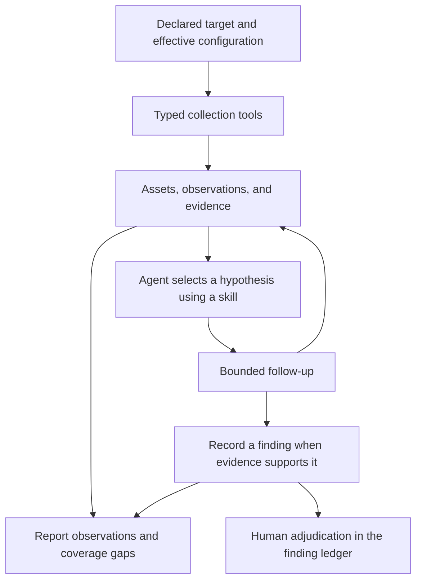

# Reconnaissance investigations in Bee

Status: Proposed design; capabilities below are not implemented unless marked existing.

Updated: 2026-10-22.

This proposal captures the direction discussed after inspecting Bee and
[ARTEX](https://github.com/jlgore/ARTEX/tree/0ca194271cc31953992b37921ca48c2387e5c399).
The [research notes](../.scratch/artex-harness/research.md) preserve the source references,
implementation limitations, and inspected revisions. The review was static; it did not run live scans
or verify deployment behavior.

## Goal and first user journey

Bee should collect reconnaissance observations, investigate promising hypotheses, and preserve the
evidence needed to review a finding. Collection techniques become typed tools; investigation
procedures become skills; Bee owns the model conversation, execution, budgets, evidence, and reports.

The first useful journey runs with one agent and one declared web target through `bee run` or
`bee repl`. The operator supplies the target, available capabilities, execution posture, and budgets.
Bee captures responses, builds an inventory of endpoints and authentication surfaces, chooses a
testable hypothesis, performs a bounded follow-up, and reports the result with evidence. When source
code is available, existing source-analysis tools can help investigate the observed endpoint.

A completed investigation may reject a hypothesis or find no defect. The report must describe what
was tested and what remains unknown; a finding is not required for a successful run.

## Mapping ARTEX into the harness

ARTEX runs a fixed collection pipeline followed by rule-based analysis and owner/hunter LLM
summaries. Bee can use its existing agent loop to select follow-up work from the collected evidence.
The capability mapping is:

| ARTEX capability | Proposed Bee implementation | Delivery |
|---|---|---|
| HTTP enrichment and technology detection | Capture HTTP exchanges; apply versioned fingerprints to stored responses | First web milestone |
| Authentication surfaces and email patterns | A reconnaissance skill over HTTP and parsing tools; distinguish observed addresses from inferred patterns | Auth surfaces first; broader collection later |
| Subdomains and DNS | Typed passive discovery and DNS workers with per-source outcomes | Collection expansion |
| Open ports and services | Bounded TCP probes or a typed Nmap adapter | Collection expansion |
| TLS assessment | Certificate inspection plus a separately provisioned engine for comprehensive checks | Collection expansion |
| Origin-IP discovery | Correlate observations into candidates, retaining evidence for each relationship | Collection expansion |
| AI analysis | Existing Bee provider and tool loop, with skills guiding hypothesis selection and validation | First web milestone |
| Reports and progress | Existing session events and REPL/TUI; add evidence-linked Markdown/JSON exports | First web milestone; PDF later |

Import measurements with their limitations. ARTEX's TLS code marks CRL checking complete without
retrieving a CRL and labels TLS 1.1 as Heartbleed; its fingerprinting code assigns confidence 100
without measuring confidence. These outputs do not establish a verified vulnerability.
[TLS implementation](https://github.com/jlgore/ARTEX/blob/0ca194271cc31953992b37921ca48c2387e5c399/modules/ssl_scanner.py#L711),
[fingerprinting implementation](https://github.com/jlgore/ARTEX/blob/0ca194271cc31953992b37921ca48c2387e5c399/modules/tech_detector.py#L85).

## Existing foundations and dependencies

| Area | Status at inspection | Use in this proposal |
|---|---|---|
| Agent loop, providers, deadlines, transcripts | Existing: [`episode.rs`](../src/episode.rs), [`repl.rs`](../src/repl.rs) | Shared interactive and headless investigation |
| Worker execution and scanner controls | Existing: [`sandbox.rs`](../src/sandbox.rs), [`tools/exec.rs`](../src/tools/exec.rs), [`scanners/mod.rs`](../src/scanners/mod.rs) | Child execution, grants, typed arguments, cleanup, and bounded output |
| Security tool outcomes | Existing: [`tools/outcome.rs`](../src/tools/outcome.rs) | Preserve completed, unavailable, and failed results |
| Finding ledger, sightings, severity, human verdicts | Existing: [`findings.rs`](../src/findings.rs) | Extend locations and evidence while retaining one ledger |
| Basic skill discovery and loading | Existing: [`skills.rs`](../src/skills.rs) | One trusted reconnaissance playbook |
| HTTP request/history/read surface | Planned: [019](../specs/019-http-intercept/plan.md) | Network collection and captured exchanges |
| Structured results and evidence references | Planned: [020](../specs/020-deterministic-tool-surface/spec.md) | Addressable observations and durable citations |
| Investigation delegation and hybrid skills | Planned: [018](../specs/018-subagent-scopes/spec.md), [022](../specs/022-hybrid-agent-skills/spec.md) | Later specialist coordination |

The existing concurrent episode runner does not provide a parent/child investigation supervisor.
The first milestone does not depend on delegation. It follows 022's direction of organizing work
around investigation quality while recording the execution backend used.

This proposal preserves [ADR-0001](adr/0001-configuration-files-are-optional.md): configuration files
remain optional inputs to a complete effective configuration. It also preserves
[ADR-0002](adr/0002-present-bee-as-one-user-facing-application.md): `bee` remains the single
application, with `run` and `repl` as the primary journeys.

## Data and evidence

The proposed terms below extend the vocabulary in [CONTEXT.md](../CONTEXT.md). Their final schemas
and glossary changes should be settled in the implementation spec.

| Record | Purpose and minimum information |
|---|---|
| Asset | A host, IP address, service, or URL with a stable identity and scope classification |
| Observation | A measured fact about an asset, with producer/version, timestamp, evidence references, and coverage |
| Relationship | An evidenced connection such as `resolves_to`, `redirects_to`, or `links_to` |
| Hypothesis | A claim to investigate, supporting observations, next validation step, and unresolved questions |
| Finding | A reviewable defect with a typed resource location, issue class, title, evidence, and sightings |
| Verdict | Existing human adjudication, recorded only through the finding ledger's human interface |

Store queryable records and relationships first. A graph database is not required. Repeated
collection should retain sightings and timestamps while avoiding duplicate asset identities. The
agent retrieves bounded subsets instead of repeatedly loading a full scan report.

The current finding location and identity use a repository-relative `path`. Extend this to a typed
resource location for files, URLs, DNS names, and services. Preserve existing file-finding IDs and
read compatibility; do not reinterpret historical paths as network resources. Network findings
extend the current source-oriented definition of Finding and require an explicit schema transition.

Use 020's harness-issued result and evidence references for both source and network tools. Reference
019's captured exchanges instead of copying response bodies into ledger strings. Evidence must remain
resolvable after the session within its retention policy; missing or expired evidence must be
reported explicitly. Preserve producer provenance for imported evidence. Redaction and retention
must apply to both artifacts and reports.

An open port, login form, or technology match is an observation. A priority for investigating it is
separate from vulnerability severity. Computed CVSS uses the supplied vector and does not establish
that the vulnerability exists. Automated collection cannot create or overwrite a human verdict.

## Tools and execution

The proposed surface combines 019's `http_scope`, `http_send`, `http_get`, and `http_history` with:

| Proposed tool | Contract |
|---|---|
| `fingerprint_http` | Analyze stored exchanges with a versioned corpus; return the matching evidence |
| `list_assets` / `get_observation` | Retrieve bounded, addressable records with provenance and coverage |
| `discover_hosts` | Query operator-enabled passive sources; retain a separate outcome for each source |
| `dns_lookup` | Accept typed names and record types; return resolver identity, status, records, and TTLs |
| `probe_ports` | Accept an explicit destination/port set within connection and time budgets |
| `inspect_tls` | Report observed handshake/certificate data and which deeper checks ran |

These names are design proposals, not available commands. Skill procedures compose the primitives
for auth discovery, takeover investigation, and origin correlation. Ordinary collection can batch
work inside bounded workers without a model turn for each individual request.

The current scanner adapter takes a filesystem `PathBuf`, checks that the target exists, and consumes
SARIF findings. Reuse its subprocess controls while introducing typed network requests and
observation results. Reconnaissance output must not become a finding merely to fit the SARIF path.
Choose linked engines or provisioned third-party tools according to the existing native-tool and
external-scanner principles; concrete engine choices remain open.

019 restricts ordinary HTTP tool children to a proxy. DNS, TCP probing, and direct TLS inspection need
explicitly authorized collector workers with narrow destination sets. TLS inspection must measure
the target's handshake and certificate, not the interception certificate. Passive-service egress is
separate from permission to test that service.

Discovery does not expand authority: redirects, CNAMEs, identity providers, mail servers, and origin
candidates must be checked against the effective configuration before follow-up traffic. Request,
host, concurrency, and time budgets are enforced in code. A skill supplies technique instructions;
loading it does not itself authorize new destinations or capabilities.

Host execution and enforced execution must be identified in run artifacts. In enforced mode, kernel
IP/port controls and application host/method/rate controls must be described separately. The current
loader attaches `socket_connect`, `file_open`, and `bprm_check_security`; this inspection did not
establish confinement of unconnected UDP sends. Resolve or explicitly constrain that protocol path
before claiming comprehensive network enforcement for DNS collection.

## Delivery sequence

| Stage | Deliverable | Completion condition |
|---|---|---|
| 1. Common evidence | Relevant 020 outcome/evidence slice and 019 prerequisites for untrusted output, error propagation, attribution, and controlled environment injection | Tool outcomes and retained evidence remain distinguishable and resolvable through the model/provider path |
| 2. First web investigation | 019 request/history/read slice; asset/observation records; fingerprinting/parsing; one trusted skill; network finding locations; Markdown/JSON report | One agent investigates one declared target and produces a reviewable result with coverage gaps |
| 3. Collection expansion | Passive host discovery, DNS, TCP probes, and comprehensive TLS checks | Each collector has explicit coverage, fixture validation, budgets, and an appropriate execution path |
| 4. Deeper investigation | Replay/fuzz capabilities and specialist delegation through 018/022 | Added capabilities improve follow-up investigations while preserving evidence and budgets |

Stage 2 includes a bounded follow-up through `http_send`; it does not require the dedicated replay
or fuzz tools. Full browser automation, general HTTPS interception of third-party clients, PDF
export, and specialist delegation are deferred.

The current 019 plan places finding evidence links in M3. This proposal brings the evidence links
needed for a reviewable report into the first web milestone. Reconcile that sequencing with 019/020
before implementation rather than building separate evidence stores or waiting for all of M3.

## Optional ARTEX comparison path

An offline importer can let Bee reason over saved ARTEX observations before all collectors exist.
Mark imported observations as externally supplied evidence and retain source revision, timestamp,
and coverage limitations. Keep ARTEX's generated analysis separate from measurements.

ARTEX's current [JSON exporter](https://github.com/jlgore/ARTEX/blob/0ca194271cc31953992b37921ca48c2387e5c399/utils/reporting.py#L1081)
omits DNS, TLS, and origin-IP sections. A complete comparison needs a complete raw snapshot export.
A temporary live CLI adapter would also need a scan-only mode, typed module/budget inputs, accurate
per-module outcomes, and deliberate handling of mixed HTTP/DNS/TLS traffic. Neither comparison path
is a dependency of the first web milestone.

## Acceptance criteria

- A fixture investigation collects observations, selects a follow-up, and records a defect with
  resolvable evidence. A clean fixture does not produce an invented finding.
- Unavailable tools, failed sources, denied redirects, and timeouts produce explicit coverage gaps.
  Partial or capped collection never appears complete, and failure never renders as a clean scan.
- Evidence references resolve after the session, or explicitly report expiry or missing artifacts.
  Fabricated and cross-session references are refused according to the shared evidence contract.
- Repeated collection merges identities and adds sightings without overwriting historical evidence
  or human verdicts. Existing file findings retain their identities through schema migration.
- Untrusted responses cannot grant authority, change the tool set, or write human verdicts.
- Reports distinguish observations, hypotheses, findings, verdicts, and untested areas. They include
  source/tool versions, execution posture, and coverage limitations.
- Host fixtures exercise the workflow. Separate VM checks verify each claimed enforced protocol
  path, destination refusal, cancellation, and descendant cleanup.

## Open implementation decisions

1. **Observation persistence:** use a shared investigation index or a separate index referencing
   019/020 artifacts; settle ownership and lifetime before defining APIs.
2. **Resource identity:** specify URL normalization, query handling, service identity, and a migration
   that preserves existing file-finding IDs and verdicts.
3. **Evidence retention:** define which payloads survive a session, how redaction affects citations,
   and how reports expose incomplete or expired evidence.
4. **Collector engines and corpora:** select and version fingerprint rules, TLS tooling, and any
   passive sources; specify provisioning and update behavior.
5. **Collector network policy:** define resolver access, protocol coverage, and separate HTTP,
   passive-source, and direct-probe worker permissions alongside 019.
